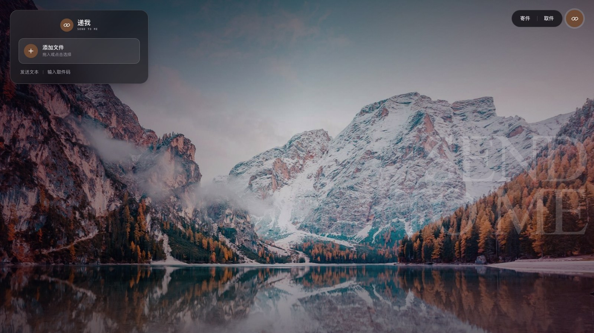

<h1 align="center">递我 · Send to Me</h1>

<p align="center">一个使用 Go 和 Vue 3 构建的文件与文本分享工具。<br>寄出内容后，将取件码或链接发给对方即可。</p>



## 功能

- 拖拽或选择文件，也可直接发送文本；多个文件打包为 ZIP 下载。
- 使用 6 位取件码或链接取件，支持设置有效期和可取件设备数。同一设备重复取件不再消耗次数。
- 相同文件按内容复用存储；支持本地磁盘和 S3 兼容对象存储。
- 管理后台支持调整寄件限制、默认设置和背景图片。
- 界面跟随系统深浅色；主题色从当前背景图提取，无法读取图片颜色时使用科技蓝。

## 快速开始

使用 Docker 构建并启动：

```bash
docker build -t send-to-me .
docker run -d --name send-to-me -p 8080:8080 -v send-to-me-data:/data send-to-me
```

打开 <http://localhost:8080>。数据保存在 Docker 卷 `send-to-me-data` 中。需启用管理后台时，在 `docker run` 中添加 `-e ADMIN_PASSWORD=你的密码`。

也可使用 Go 1.26、Node.js 24 和 pnpm 12 从源码启动：

```bash
cp .env.example .env
make run
```

`make run` 会构建前端和服务端，并读取 `.env`。

## 管理与配置

在 `.env` 中设置 `ADMIN_PASSWORD`，重启后访问 `/admin`。未设置密码时管理后台关闭。

| 配置 | 用途 |
| --- | --- |
| `ADDR` | 监听地址，默认 `:8080` |
| `DATA_DIR` | 数据目录，默认 `./data` |
| `PUBLIC_BASE_URL` | 对外访问地址，用于生成取件链接 |
| `MAX_UPLOAD_MB` / `MAX_FILES` / `MAX_TEXT_KB` | 寄件限制的初始值 |
| `STORAGE_DRIVER` | `local` 或 `s3` |
| `TRUST_PROXY` | 仅在可信反向代理后启用 |

完整环境变量、S3 配置和 API 说明见 [配置与接口参考](docs/reference.md)。后台保存的设置存放在 SQLite 中，并覆盖对应的环境变量初始值。上传的背景图存放在 `DATA_DIR/backgrounds/`；外链背景若不允许跨域读取，页面仍可显示图片，但取色会回退到默认蓝色。

## 开发与测试

```bash
make frontend    # 构建前端（Go 嵌入 web/dist）
make test        # Go 测试
make test-web    # 前端类型检查
```

开发时可先执行 `make frontend`，再分别运行 `go run .` 和 `cd web && pnpm run dev`。Vite 开发地址为 <http://localhost:5173>。

## 部署提示

取件码和链接相当于访问凭证；项目不提供病毒扫描或文件内容加密。公开部署时建议启用 HTTPS，并在反向代理处配置限流。请妥善保管 `.env` 和数据目录，不要提交密码或用户文件。

## 许可证

项目采用 [MIT 许可证](LICENSE)。文件格式图标来自 [Carbon Icons](https://carbondesignsystem.com/elements/icons/library/)，使用 [Apache-2.0 许可证](docs/Apache-2.0.txt)。
